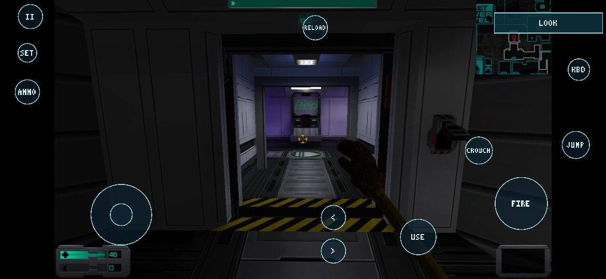
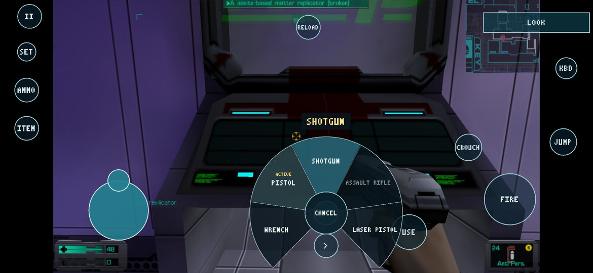
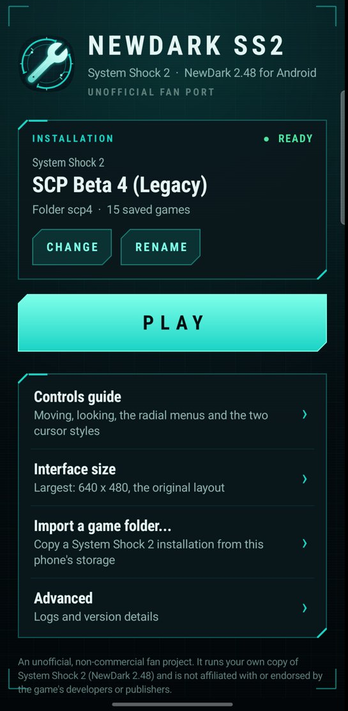

# NewDarkAndroid

**An unofficial Android port of System Shock 2 (NewDark 2.48), with full touchscreen controls, built from your own
copy of the game.**

This is the project's main repository. It holds the current release source, the downloads, the documentation and the
feature list.

| Looking for… | Go to |
| --- | --- |
| The download | [v0.1.0-beta.1 source release](https://github.com/thekojac304/NewDarkAndroid/releases/tag/v0.1.0-beta.1). It is **source only**: there is no APK, and [Download](#download-source-only) explains why |
| What it does | [Features](#features) and [what this project built](#what-this-project-built) |
| What has been tested | [Status and testing](#status-and-testing) |
| How to build and play | [Getting started](#getting-started) |
| The full engineering history | [NewDarkAndroid-development-history](https://github.com/thekojac304/NewDarkAndroid-development-history): every development phase, with test reports and device screenshots |

> **Status: v0.1.0-beta.1, a source-only beta.** It plays System Shock 2 and the System Shock 2 Community Patch (SCP)
> on an ARM64 Android phone with a touchscreen. Not affiliated with, endorsed by or sponsored by Nightdive Studios,
> Looking Glass Studios, the SCP team or any other rights holder. "System Shock" and "System Shock 2" belong to their
> owners.

  

  
  

A local build running on a Galaxy S26 Ultra (Android 17): gameplay with the touch controls, the
radial weapon menu, and the launcher.

## Download: source only

**[v0.1.0-beta.1](https://github.com/thekojac304/NewDarkAndroid/releases/tag/v0.1.0-beta.1)**:
`NewDarkAndroid-v0.1.0-beta.1-source.zip` or `.tar.gz`, with `SHA256SUMS.txt`.

There is **no installable APK**, and none can be published as things stand. An APK of this port contains System
Shock 2's own program code, translated into C and compiled in. That code is copyrighted, so each player builds the
APK on a PC from their own copy of the game ([docs/android/BUILDING.md](docs/android/BUILDING.md)).

### Public source and local builds

The source release holds **all of the port's code**. Personal builds, such as those shown in the screenshots, use the
same code. There are two differences:

- **A local build also contains code generated from the player's own `SS2.exe`** and its modules. The build creates
  this code on the player's PC. It is never committed, never published, and must not be shared.
- **The evidence files are not in the source release.** The per-phase test logs, scripts and device screenshots are
  in [NewDarkAndroid-development-history](https://github.com/thekojac304/NewDarkAndroid-development-history).

### An installable APK: blocked

An APK that anyone could install would have to do the translation on the phone, from the player's own `SS2.exe`.
That is not built.

A feasibility probe on 2026-11-10 found that Android 17 lets an app load a library it compiled itself. Still missing:

- an Android build of the translator;
- an ARM64 compiler toolchain packaged inside the APK;
- a measurement of how long compiling about 180 MB of generated C takes on a phone.

## Features

What a build of v0.1.0-beta.1 does:

- **Plays the game:** new game, the intro and start cutscenes (Indeo 5), save and load, audio, the PDA and inventory.
  Tested areas include Earth, the MedSci deck and loading saves made on other decks. See
  [status and testing](#status-and-testing) for what hasn't been played through.
- **Touch controls:**
  - a floating move stick and swipe to look;
  - **FIRE** (drag to aim), **USE**, **JUMP**, **CROUCH**, **RELOAD**;
  - a **LOOK / CURSOR** mode toggle, with a direct or trackpad-style (relative) cursor;
  - an on-screen keyboard (**KBD**) and a layout editor (**SET**).
- **Radial menus anchored to the button you hold:**
  - weapons, ammo types and firing modes, psi powers, hypos and patches;
  - a system wheel for quicksave, quickload and logs.

  The menus are filled from the game's live state and fan out along screen edges so they stay reachable.
- **Launcher:**
  - an installation card with **PLAY**;
  - switching between installations, and renaming them;
  - interface size, from 640×480 upward;
  - an illustrated controls guide;
  - an **Advanced** page with logs and version details.
- **Game-folder import** through Android's folder picker, with no storage permission. It scans and checks the folder
  before writing, and verifies that `SS2.exe` is the 2.48 build. It can also import saves, and recovers from an
  interrupted import.
- **Mods:**
  - Data mods work as on PC: DML, scripts, assets and `cam_mod.ini` order.
  - Native `.osm` modules work if they were recompiled into your build.
  - Two NVScript versions are supported side by side, chosen at run time from the file's identity: **SCP Beta 8** and
    **NVScript 1.2.4 (SCP Beta 4)**. Old Beta 4 saves keep loading.
- **Upgrades keep your data:** saves, settings and imported games survive an app update.
- **Keyboard and mouse:** the Android input path supports a physical keyboard and mouse. Only virtual (emulated) USB
  devices have been tested; real hardware hasn't. Gamepads are not supported.

## What this project built

System Shock 2's engine source has never been released. The port stands on
[Owloeb/NewDarkRecompiled](https://github.com/Owloeb/NewDarkRecompiled), which recompiles the retail 32-bit x86
`SS2.exe` into C. It also provides the portable host underneath: Win32, DirectX and DirectSound shims, an SDL 2 backend,
the OpenGL ES renderer and the built-in Indeo 5 cutscene decoder.

| Area | Upstream NewDarkRecompiled | Added by this project |
| --- | --- | --- |
| Recompiler | Static x86 → C translation; Windows and portable hosts | SSE/SSE2, `cmov`, `bsf`/`bsr`, `xadd`, `cmpxchg` and MPX-prefix support, static TLS and newer-CRT shims. These were needed to recompile SCP's NVScript, and were tested against the real CPU |
| Android runtime | — | The Android entry point, native build and APK packaging. An ARM64 runtime fix (`setjmp` under NDK clang), and a conformance suite that passes all 511 checks on the device |
| Rendering | GLES 2.0 renderer, pixel shaders, per-pixel lighting | Android GL context and lifecycle (pause, resume), and scaling of the 2D interface to phone resolutions |
| Audio | Game mixer → SDL | Android audio output. A legacy `cam.cfg` OpenAL setting is redirected so old installations play sound |
| Saves | The engine's own save/load | A separate writable folder for each installation, and a fix to the virtual file system's listing of written files |
| Input | Desktop keyboard and mouse | The whole touch layer: a bridge to System Shock 2, a GLES renderer for the overlay, the radial menus, relative cursor and CROUCH that respects the game's key binding. The touch core (stick, look, wheel, editor) is adapted from Shockolate's GPL touch controls |
| Android app | — | Launcher, game-folder importer, installation profiles, controls guide, adaptive icon |
| SCP support | — | Two NVScript builds in one APK, selected by file identity |
| Release | — | Allowlist/denylist export tooling, so the public source contains nothing generated from the game |

## Status and testing

Tested on **one device**, a Samsung Galaxy S26 Ultra (Android 17, Adreno 840, 2340×1080). Testing combined scripted
runs, using injected touch and mouse input, with the owner's own play.

**Works on the device:**
- the runtime conformance suite (511 of 511 checks);
- start-up, the intro cutscene and menus;
- a new game; Earth and MedSci in 3D, with movement, looking around, using objects, the inventory, the PDA and melee;
- save and load, including after a cold restart;
- 99–100 fps on MedSci, which is the game's own cap;
- resuming the same process after Home or Recents;
- the SCP Beta 8 module gate and the Earth lift;
- 15 legacy SCP Beta 4 saves loading;
- every radial menu, at three resolutions;
- the launcher, the importer, and an in-place upgrade that kept 8,207 game files and 174 save files identical.

**Not verified yet:**
- deck changes by elevator;
- ranged combat against enemies, replicators, and psi in real play;
- a full campaign, or long sessions;
- turning the screen off and on, and the app being killed for low memory;
- real (not emulated) keyboards and mice;
- any device other than the S26 Ultra.

More detail: [known limitations](docs/android/KNOWN_LIMITATIONS.md).

## Requirements

| | |
| --- | --- |
| Device | Android 8.0+ (API 26), **ARM64** (`arm64-v8a`), OpenGL ES 2.0, a touchscreen |
| Game | A legitimate **System Shock 2 with the NewDark 2.48 executable**, from GOG or Steam. The 25th Anniversary Remaster is a different engine and does not work. `SS2.exe` must be the retail 2.48 file: 5,121,024 bytes, sha256 `c7ff08c5a1837942410cc2328b4a6579ddb1d5a2678b8274db8b0347ce19823e` |
| PC for building | **Windows**. It's the only system the build has been run on. Python 3.12–3.14, JDK 17, Android SDK platform 34, NDK `29.0.14206865`, CMake 3.22.1, and a clone of SDL 2.32.10. See [docs/android/BUILDING.md](docs/android/BUILDING.md) |

## Getting started

1. **Build** the APK on your PC against your own game: [docs/android/BUILDING.md](docs/android/BUILDING.md).
2. **Install** it (`adb install`), then put the game on the phone, either with the launcher's importer or with
   `adb push`: [docs/android/GAME_FILES.md](docs/android/GAME_FILES.md).
3. **Play** with the [touch controls guide](docs/android/CONTROLS.md).
4. Using SCP or other mods? See [docs/android/MODS.md](docs/android/MODS.md).
5. Trouble? See [docs/android/TROUBLESHOOTING.md](docs/android/TROUBLESHOOTING.md).

**Do not distribute APKs you build**: they contain code generated from a copyrighted executable.

## Repository layout

| Path | What |
| --- | --- |
| `lift.py`, `lift_*.py`, `host/`, `runtime/`, `tools/`, `harness/`, `symbols/` | The recompiler and Windows host: upstream NewDarkRecompiled (MIT), with our additions such as `lift_sse.py` |
| `port/` | The portable host: Win32/DirectX/DirectSound shims, SDL 2 + GLES backend, the Android entry point |
| `port/backends/android/touch/` | The touch controls (**GPL-3.0-or-later**, derived from Shockolate) |
| `video/` | The built-in Indeo 5 cutscene decoder (unmodified FFmpeg, LGPL-2.1) |
| `android/` | The Android app (Gradle), the native build script and test tools |
| `docs/android/` | User and developer documentation for the Android port |
| `docs/android-audit/` | Development phase reports. The screenshots and logs they mention are in the [development history repository](https://github.com/thekojac304/NewDarkAndroid-development-history/tree/release/v0.1.0-beta.1-prep/docs/android-audit) |
| `docs/release/` | Release notes, licensing review and publication checklist |
| `docs/UPSTREAM_README.md` | The upstream project's README (Windows and Linux hosts, recompiler internals) |

## Licensing

Licensing is mixed, per directory:

- the tools are MIT;
- the touch controls are GPL-3.0-or-later;
- FFmpeg's Indeo decoder is LGPL-2.1;
- SDL 2 is zlib. You clone it yourself when building, and it isn't stored here.
- **The game, and anything generated from it, is not licensed to you by this repository at all.**

Details and the full attribution list: [LICENSING.md](LICENSING.md) and [THIRD_PARTY_NOTICES.md](THIRD_PARTY_NOTICES.md).

## Credits

- **[Owloeb/NewDarkRecompiled](https://github.com/Owloeb/NewDarkRecompiled)**: the static recompiler, the Windows and
  portable hosts, the DirectX/Win32 layers, the GLES renderer and the cutscene decoder this port stands on. Without it
  there is nothing here.
- **[Shockolate](https://github.com/Interrupt/systemshock)** (GPL-3.0-or-later) and its Halo-derived Android
  touch-control design: the touch-control core (floating stick, look, FIRE/USE, radial selector, settings and layout
  editor).
- **[SDL](https://libsdl.org)**, **[FFmpeg](https://ffmpeg.org)** (Indeo 5 decoder), and the Android NDK and SDK.
- **Looking Glass Studios** made System Shock 2, and **Nightdive Studios** maintain the rights. The NewDark engine updates
  this port targets are the work of Tom N Harris and the NewDark contributors. The **System Shock 2 Community Patch**
  is the work of its own team. None of them is involved in, or responsible for, this project.

This is a fan project made for people who already own the game.
